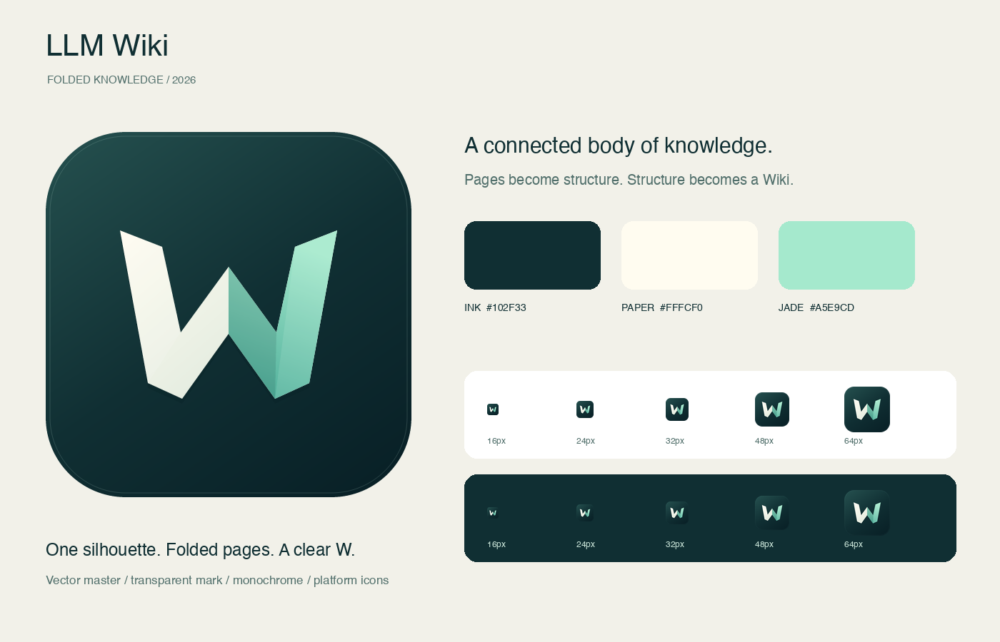

# LLM Wiki · Folded Knowledge



零散资料经 LLM 整理为结构化页面，页面相互连接，积累为可以持续更新的 Wiki。新符号将连接的折页合成一个 W：连续轮廓代表知识累积，折面代表从原始资料到结构化知识的转换，W 对应 Wiki。

保留现有深墨绿品牌基调，以暖纸白和玉石绿形成清晰对比。质感来自折面与轻微色阶，单色版本保留相同轮廓。图形不依赖文字、细线或小节点。

## 资产

- `src/assets/brand/llm-wiki-icon.svg`：完整应用图标，1024 单位矢量母版。
- `src/assets/brand/llm-wiki-mark.svg`：透明背景彩色符号。
- `src/assets/brand/llm-wiki-monochrome.svg`：白色单色符号，用于深色背景与系统单色图标。
- `logo.png` / `src/assets/logo.png`：512px PNG。
- `src-tauri/icons/`：桌面 ICNS / ICO / PNG、Windows 磁贴和移动平台资产。
- `public/favicon.png` / `extension/icon*.png`：浏览器与扩展图标。

透明符号在浅色底上应加深墨绿容器；小尺寸优先使用完整应用图标。不要额外叠加节点、光晕或文字。色板为墨绿 `#102F33`、纸白 `#FFFCF0`、玉绿 `#A5E9CD`。

## 再生成

在应用根目录运行：

```sh
npm run tauri -- icon src/assets/brand/icon-manifest.json
python3 scripts/export-brand-assets.py
npx vitest run src/lib/brand-assets.test.ts
```

导出脚本使用构建环境的 Pillow；应用没有新增运行时依赖。主图形直接以 SVG 构造，未使用 AI 位图生成。
